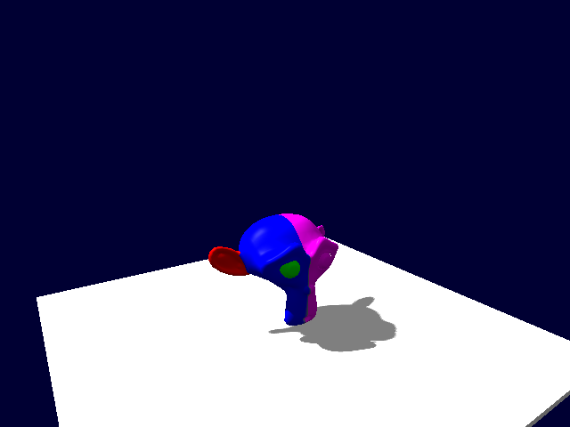
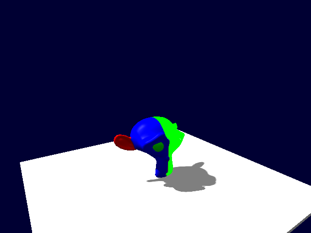

# Поддержка нескольких материалов и регрессии r3

Начальная реализация: 2026.11.05.7; исправление пользовательского круга: **2026.11.05.8**.
Сохраняются все исправления .6 (тени и UV).

| Функция / жалоба | Поддерживаемый вызов | Проверка |
|---|---|---|
| LIM001 предыдущего прогона: первый материал покрывал всю модель | asset.import; SceneAssets::CreateModel | FBX и настоящий Blender Suzanne: два source material IDs, два материала на реальных пикселях |
| Отдельное назначение | SkeletalMeshComponent::SetMaterialSlot; project.scene property | Изменяется одна часть, неизвестный ID/escaping path отклоняется без мутации |
| Инспектор | project.scene property / штатный ObjectInspectorPanel | Поля source ID+имя, .mat picker, кнопка открытия нужного материала, disabled при пустом пути; native EditorUiTests |
| История / сцена | project.scene model/property/undo/redo/save/load/duplicate | Импорт + 13 реальных операций редактора; data возвращается в JSON |
| SaveGame | SaveGame::Capture/Restore | Оба пути материалов переживают восстановление сцены внутри SaveGame |
| Рендер / тени | Game::RenderViewportFrame | Custom/Forward/Deferred, разные opaque/transparent slots, masked shadows, castShadows, текущая bone palette, error/reload |
| Диагностика | GetFrameStats / завершённый кадр | Модель с двумя материалами остаётся одним видимым объектом; draw calls считают реальные диапазоны |
| BUG-R3-001: наследник Skeletal не загружался | SceneDocument::Restore, SaveGame::Restore, project.scene load/duplicate | До исправления `Material slots do not match model`; после .8: свой тип, геометрия и оба материала восстановлены, включая batch remap и исходный save .7 из игры |

Геометрия, палитра костей и object constants общие. Внутренние render-only части попадают в
обычные проходы материалов; отдельные игровые Scene objects не создаются. Номер материала
берётся из исходного aiMesh, не из порядка его обхода. Manifest v2 хранит явное соответствие;
v1 поддерживается при новом размещении. Старая сохранённая сцена сохраняет общий override.

На начальной .7 прошли: Asset workflow **499**, SaveGame **78** + cross-process,
RenderDiagnostics **124**, Core **54/54**, Skeletal **8/8**, native EditorUiTests **5033**,
Assimp commandlets **7/7**. Количества checks не равны количеству уникальных функций.
Команды, кадры и логи: [evidence](evidence/).

На итоговой .8: **Assets 506**, **SaveGame 78 + cross-process**, **Core 54/54**,
**native EditorUiTests 5034**, повтор **MaterialSlotsCommandletTests (13 операций)** — PASS.
RenderDiagnostics/Skeletal/Assimp commandlets выше относятся к .7; после локального исправления
порядка восстановления их отдельные runner повторно не запускались. GPU/material проверки входят
в повторённый Asset workflow. Все четыре проекта пересобраны и повторены с согласованным SDK .8;
прицельные результаты и ограничения находятся в дневниках, не выдаются за новый полный круг.

Исходный FAIL зафиксирован до правки: [derived-before.log](evidence/derived-before.log).
Проверенный FAIL→PASS: [derived-after.log](evidence/derived-after.log),
[final8-assets.log](evidence/final8-assets.log). В игре про броски восстановлен тот же save .7:
предмет продолжил полёт с elapsed=0.5 и дал попадание. Хэши новой замороженной поставки:
[final8-hashes.json](evidence/final8-hashes.json).




Для воспроизведения из корня репозитория:

```powershell
& Engine/tests/assets/run-blend.ps1
& Editor/tests/MaterialSlotsCommandletTests.ps1 -Project <scratch/Project.json> -Model <self-contained.blend> -Output <new-output>
```

Последняя команда меняет только указанный scratch-проект; не направляйте тест на рабочий проект.
Blender требуется для .blend; разбор scene properties не требует уже открытого редактора.
GPU-пробы требуют D3D11; offscreen Qt не заменяет проверку изображения.

Не добавлялись полный PBR, импорт произвольного графа Blender, автоматический перенос OBJ/MTL,
попиксельная сортировка пересекающейся прозрачности. GLB/glTF теперь получают Base Color
автоматически, как FBX/BLEND. Эти ограничения не выдаются за исправленные дефекты.
