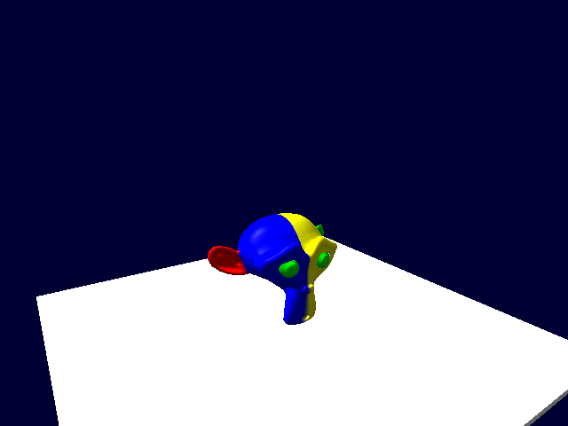
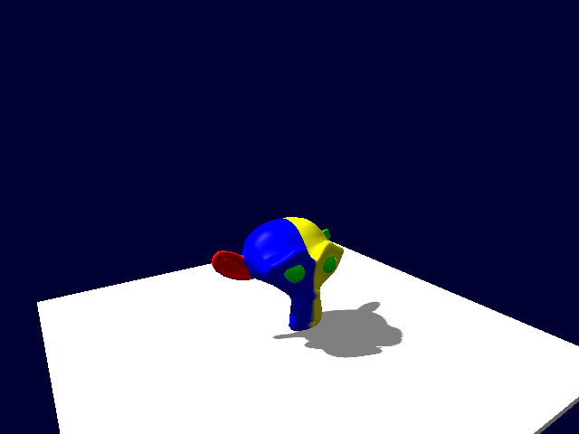

# Импортированные модели: тени и материалы

Проверено 2026-11-05. Исходная версия 2026.11.05.5 (`26e3bfe`), исправления — 2026.11.05.6.
Release x64, MSVC v143, Assimp, Blender 5.2.3 LTS, NVIDIA RTX 4070 Laptop GPU, Direct3D 11.

Исходную модель из внешнего отзыва получить нельзя. Использована **Suzanne — встроенная модель
Blender**, с subdivide, UV и упакованной четырёхцветной текстурой. Добавлены вариант с двумя
материалами и плоская UV-карта. Это воспроизводимые локальные модели, не скачанный сторонний ассет.
Генератор: `Engine/tests/assets/make-blend-fixtures.py`; готовые `.blend` лежат в `evidence/`.
Импорт выполнялся штатным Edit API: `.blend` → Blender → GLB → Assimp → SceneAssets → GPU.

## Результаты

| ID | Найдено | Причина и результат |
|---|---|---|
| IM001 | Импортированная модель не отбрасывает тень | **Исправлено.** SceneAssets создаёт SkeletalMeshComponent и для статических моделей, а компонент безусловно возвращал CastsShadow=false и не реализовывал RenderShadow. Добавлен проход с актуальной bone palette, transform/yaw, opaque/masked и castShadows. Без назначенного материала используется стандартный материал, включая получение теней и Deferred. |
| IM002 | Отдельная текстура объекта перевёрнута относительно BaseMap материала | **Исправлено.** Assimp уже преобразует UV в верхнее начало координат, но TrySetTexture дополнительно переворачивал изображение. Для skinned/imported UV убран второй переворот; исторические примитивы сохраняют прежнее поведение. |
| LIM001 | Второй материал Suzanne теряется при отображении | **Подтверждённое незакрытое ограничение.** Оба .mat сохранены импортом, но первый назначается всему объекту. Меш рендерится одним диапазоном индексов. Нужны сохранение material index каждого submesh и отрисовка диапазонов соответствующими материалами, затем согласование scene/savegame/инспектора. Это не ошибка UV и не полная поддержка Blender-материалов. |

У сложных исходных моделей остаются ограничения Base Color/UV0: normal/roughness/metallic,
процедурные узлы и преобразования UV материала не переносятся. Без исходного файла нельзя
утверждать, какая из этих причин вызвала внешний отзыв.

До исправления включение теней давало **0** затемнённых пикселей земли от Suzanne;
после — **4642** в итоговом контрольном Custom-кадре. Все проверенные углы UV после исправления совпадают:
красный сверху слева, зелёный сверху справа, синий снизу слева, жёлтый снизу справа.
Обе картинки проверены на реальном GPU, не только по наличию SRV или числу draw calls.




## Регрессии и сборка

- Asset workflow с реальными Blender-fixtures: **437 checks passed**. Перенос проекта,
  обычные FBX/GLB и BLEND, сравнение BaseMap/текстуры объекта, видимая тень в Custom/Forward/Deferred,
  чтение глубины каскадов, стандартный материал, masked, castShadows=false, анимация без задержки
  на кадр, статический кэш и его инвалидирование при изменении model yaw.
- Анимационная проверка использует геометрию импортированной Suzanne с синтетическим одним
  суставом и клипом перемещения: это проверка GPU-позы, не заявление об импорте Blender-рига.
- Core: **54/54**, Skeletal: **8/8** (включая CesiumMan и baker), RenderDiagnostics: **124 checks**.
- AssimpCommandletTests: **7/7** сценариев — OBJ, FBX, GLB, внешний/упакованный BLEND,
  повреждённый FBX и отсутствующая текстура BLEND.
- Release Runtime, EditorModule, SceneProject, EngineCommandlets и SDK пересобраны.
  Рабочий пакет: `Game/build/x64/Release/Runtime`, версия **2026.11.05.6**.
  Закреплённые старые runtime и прежние playtest-снимки не менялись.
  SHA256 SDK/Lib/Engine.lib: `48B385E2EDB967B5C2C64B4BD19356496C981420C6339630BC828B1672BEC62D`;
  библиотека и заголовок SkeletalMeshComponent совпадают с текущей сборкой.
- API Reference перегенерирован; `node Engine/docs/api-reference/build.mjs --check` и
  `git diff --check` проходят. Документация PROJECT-ASSETS, MATERIALS, ENGINE-VERSIONS,
  COMMANDLETS обновлена.

Учтены также ошибки самого теста: первая сборка дала **C2660** (SetViewDirection требует forward
и up); исправлено добавлением up. Первый UV-кадр оказался обратной стороной плоскости и был
отсечён; fixture-проверка сделана двусторонней, затем плоскость повёрнута к камере. Это ошибки
проверочного сценария, не дополнительные дефекты движка. Исходные логи сохранены в evidence.
Второй baseline уже показал вертикальное несовпадение двух способов назначения картинки.

## Повторение

Из корня репозитория:

```powershell
& Engine/tests/assets/run-blend.ps1
```

Runner создаёт новые fixtures и проект, поэтому прежние доказательства не перезаписываются.
Для отдельного asset-прогона с подготовленными fixtures:

```powershell
$env:PAINENGINE_BLENDER = 'C:/Program Files/Blender Foundation/Blender 5.2/blender.exe'
$env:PAINENGINE_BLEND_FIXTURES = 'E:/Engine/Engine/build/imported-model-probe/fixtures'
& Engine/tests/assets/run.ps1 -Configuration Release -PlatformToolset v143 -EnableAssimp
```

Логи в `evidence/`; заключительный повтор с явной проверкой четвёртого UV-угла —
`final-four-corners.log`, также **437 checks passed**. Исходные BMP кадров этого отчёта — в
`Engine/build/asset-tests/Проект a974163e20ce44a5bdb6227972d6519d-moved/`.
PNG в отчёте — преобразование тех же кадров без изменения пикселей.

Пользовательский проект должен запускаться на новом runtime (через обновление копии проекта в
лаунчере). Если в старом проекте UV-переворот компенсировался заранее перевёрнутым изображением,
верните исходную картинку. C++-модули пересобираются с согласованным SDK.
