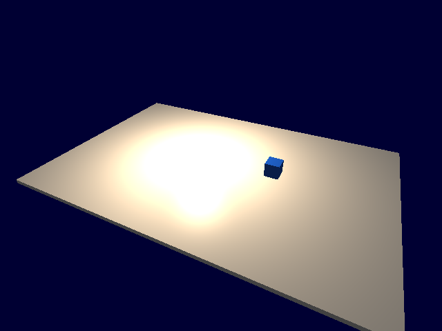
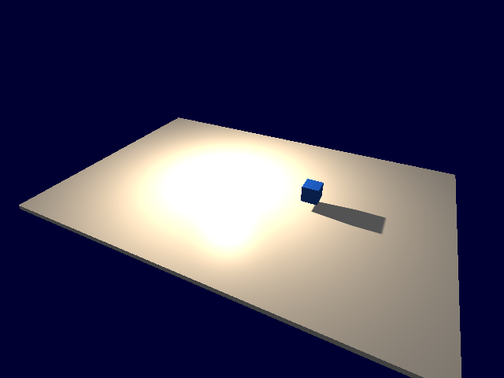
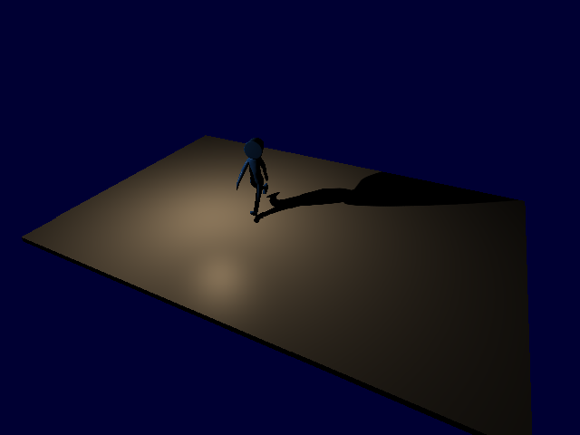

# Движение точечных теней — 2026.11.07.2

Запрос: проверить тени при движении лампы и анимированных объектов, исправить
найденное и обновить сборку. Windows x64 Release, MSVC v143, Assimp,
NVIDIA GeForce RTX 4070 Laptop GPU. Все проверки выполнялись в scratch;
пользовательские проекты и прежний выпуск .1 сохранены.

## Воспроизведение и исправления

| Дефект / функция | Команда | Ожидание и регрессия | Итог |
|---|---|---|---|
| VAT-поза выходит за bind sphere | `render.point-shadows`, caster=crowd, time=.5 | Probe [8,0,0] затенён, как у skeletal/rigid reference | Исправлено |
| Лампа без солнца | Та же команда, sceneLighting=true | Point cube активен при неактивных каскадах, тень видна в цвете | Исправлено |
| Замена LOD после bake | replaceLodOffset=[6,0,0], position=[-12,1,0], radius=5 | Новая геометрия в радиусе лампы не отсечена устаревшим envelope | Исправлено |
| Движение/возврат света и позы | motion-сценарии, mesh/skeletal/crowd/manual VAT | Карты и BMP после возврата совпадают точно; старая тень исчезает | PASS |
| Переход между гранями | seam-сценарии, шаг анимации 1/60 s | Во всех 31 состояниях тень сохраняется, карты изменяются | PASS |
| Анимация входит в радиус лампы из-за его пределов | radius-сценарии | Учитывается анимированный hull, а не только origin | PASS |
| Низкоуровневая внешняя VAT-текстура | manualTexture=true | Неизвестные bounds не вызывают ложного отсечения | PASS |
| Глобальный/сценовый переключатель | global-off-сценарии | Legacy global-off отключает тени; scene lamps независимы от солнца | PASS |

Первый диагностический запуск не включал общий shadow switch и давал count=0
для всех casters; это ошибка fixture, не свидетельство VAT-дефекта.
Baseline ниже записан после исправления fixture и перелинковки commandlet
с прежним Engine.lib (до компиляции изменений ядра).

В подтверждённом baseline кость переносит куб на X=6, лампа стоит [0,4,0].
Skeletal caster записывает +X грань: probe [8,0,0] имеет stored=0.924535,
expected=0.953390, occluded=true. VAT даёт stored=1, occluded=false.
После исправления оба дают одинаковую карту и затенённую точку.
Сцена без солнца в baseline даёт count=0, после исправления count=1.
JSON: [baseline](fixes/baseline), [финальный исходный прогон](fixes/final/summary.json).

До исправления:

После исправления:

`BakeSkeletalModel` вычисляет сферу всех sampled poses с реальными UNORM8 весами
crowd vertex. Линейная интерполяция остаётся внутри сферы. Штатные LODы копируют
исходные вершины, поэтому покрыты тем же envelope. Отдельный радиус отсечения
не меняет screen-size LOD. Внешняя VAT без bounds проходит консервативно;
пользовательская замена LOD сбрасывает прежний envelope. Этот последний случай
найден при ревизии кода, отдельного GPU baseline для него не записывали.

Point-only сцена инициализирует общий shadow pipeline; Forward/Deferred
привязывают cube/samplers независимо от каскадов. Instanced point streams
также не зависят от активности directional shadows.

## Проверки

- EngineTests: **64/64**, 0 skipped, включая quantized VAT envelope, интерполяцию
  через loop seam и прежние каскадные GPU-регрессии.
- Исходный финальный GPU-прогон до добавления replacement-LOD case:
  **32 сценария, 280 кадров**, Forward/Deferred, с обычным и сценовым светом.
  Все face hashes synthetic animation совпали с rigid reference.
- Финальные бинарники **из пакета**: **34 сценария, 282 кадра**, включая замену
  skinned LOD. Все PASS: [результат](fixes/packaged/summary.json).
- Осмотрены BMP до/после, три положения на cube seam, импортированный CesiumMan
  с изменением позы/лампы в skeletal и VAT путях. В осмотренных кадрах тень
  соответствует позе и положению лампы; новых разрывов не обнаружено.
- Release All: Engine, Runtime, Editor, SDK, Launcher и примеры — PASS.
- Frozen binary fixtures: **116** проверок; legacy Qt UI: **387** — PASS.
- Tangent commandlets: **7** сценариев; point-light duplicate/save/new/load — PASS.
- API Reference `--check`: 39 страниц, 308 API entries, 97 headers — PASS.
- `git diff --check` — PASS.

Воспроизводимый runner: `Editor/tests/PointShadowMotionTests.py`.
Он использует настоящий D3D11 renderer, захватывает BMP и читает depth cube.
`occluded` сравнивает raw depth; PCF/bias цветового прохода проверены отдельно
различием shadow-on/off BMP и визуальным осмотром. SHA-сравнения возврата
выполняются внутри одного backend, не между Forward и Deferred.
Исходные BMP: `Engine/build/playtests/20261107-point/final-motion`.
Финальные BMP пакета: `Engine/build/playtests/20261107-point/packaged-motion`.

В smoke runner исправлено ожидание launcher: `Start-Process -Wait` ожидал
также оставшийся фоновый PDB-сервис MSVC после успешного `--enable-code`.
Теперь runner ждёт `Process.WaitForExit()` только вызванного launcher.
Первый CodeBuild.log уже подтверждал validated/activated; последующий чистый
проект проверяется исправленным runner. Это исправление тестового сценария,
не дополнительный дефект движка.

## Границы проверки

Проверена одна движущаяся лампа, синтетическая кость и CesiumMan на одном GPU;
это не полный перебор моделей, материалов, двухлампового выбора слотов или
всех вертикальных траекторий. Субтексельный raster aliasing возможен.
Внешняя VAT без bounds рисует больше casters/faces — корректность ценой работы GPU.
Явные draw/shadow distance сохраняются. Point-only путь использует общие
ресурсы каскадного pipeline, включая его texture allocation.
Коммит и публикация не выполнялись.

## Поставка

Готовый пакет: `Engine/build/releases/PainEngine-2026.11.07.2-win64.zip`.
Упакованные 6 игр и 2 редактора прошли smoke; новый C++-проект создан,
собран с SDK и запущен в Game/Editor: [12 успешных шагов](package-smoke.json).
Engine.lib в SDK и EngineCommandlets.exe проверены по SHA-256 против финальной
сборки. Сценарий упаковки удаляет только сгенерированные cache-каталоги внутри
новой поставки, формирует SHA256SUMS и проверяет CRC/хэш каждого файла ZIP.
Результат: [package-verification.json](package-verification.json).

Повторение: `package.ps1` → `validate-package.ps1`, packaged
`Diagnostics/PointShadowMotionTests.py` → `seal-package.ps1`.
Проверки сохраняют материалы в `Engine/build/playtests/20261107-point`;
`collect-evidence.ps1` переносит JSON/логи и PNG в этот отчёт.
Предыдущий ZIP .1 не изменён. Для C++-проектов требуется пересборка с новым SDK.

Общий недельный счётчик аккаунта: 57% перед работой, 58% на финальной проверке;
это расход всего аккаунта, не точный расход этого чата.
