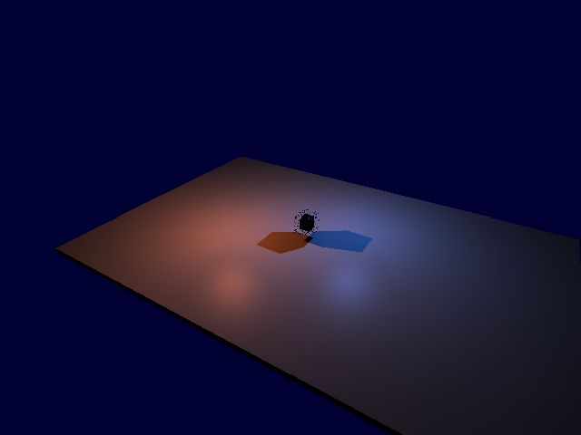
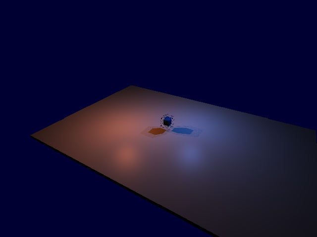
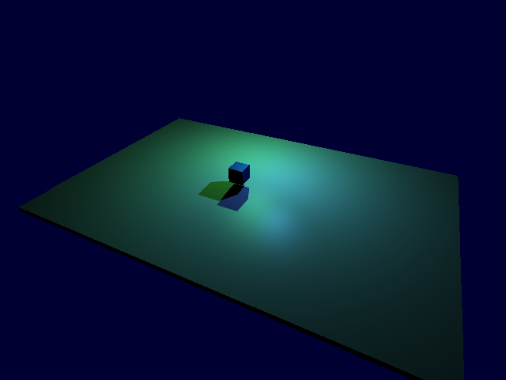
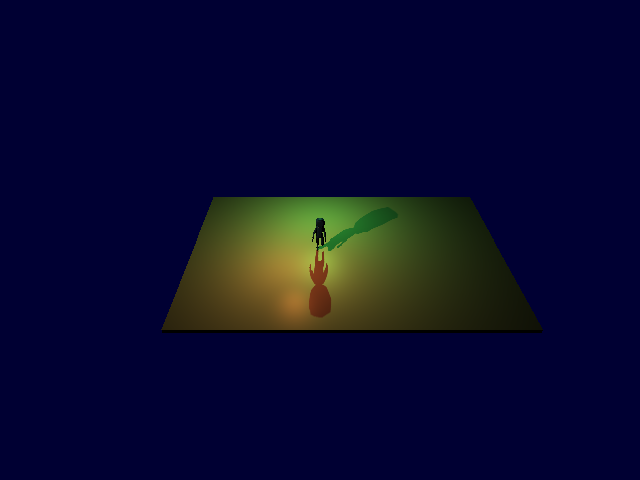

# Две теневые лампы, слоты и анимированные LOD — 2026.11.07.3

Запрос: проверить две лампы одновременно, переключение слотов и LOD у
анимированных объектов, исправить найденное, обновить сборку.
Windows x64, MSVC v143 Release, Assimp, NVIDIA GeForce RTX 4070 Laptop GPU.
Прежние правки и выпуск .2 сохранены; проекты проверяются в scratch.

## Покрытие и дефекты

| Функция / BUG | Команда / сценарий | Наблюдаемый контракт | Результат |
|---|---|---|---|
| Два shadow cube одновременно | `render.point-shadows`, lights=[A,B,C], slots-* | A/B занимают 0/1, C светит без тени; обе карты содержат тень caster | PASS |
| Отключение, castShadows, малый radius | slots-* | Следующая лампа получает освободившийся слот; её карта не зависит от номера слота | PASS |
| BUG-01: intensity=0 удерживает слот | slots-*, кадры 7/8 | Погашенные лампы не занимают карты; C получает слот | Исправлено |
| BUG-02: скачок тени в конце LOD fade | fade-*, 9 состояний на полосу | Оба cube плавно меняют силуэт вместе с цветовым LOD | Исправлено |
| Материал и legacy path | fade-* и fade-*-material | Signed fade доходит до depth PS в обоих путях | PASS |
| Distance LOD | distance-*, synthetic/CesiumMan | Реальные buckets 0→1→2, карта стабильна внутри уровня, возврат точный | PASS |
| Анимация + движение света/камеры + слоты | joint-*, skeletal/crowd | Правильные владельцы обоих кубов; повтор состояния даёт те же карты/BMP | PASS |

Диагностика расширяет существующий `render.point-shadows`: читает обе карты
(12 faces), реальные `FrameConstants.LightParams.w`, LOD buckets. Один и тот же
source shader/geometry path используется для визуального кадра и readback.
Старые single-light поля результата сохранены.

## До исправления

Baseline — расширенный commandlet, собранный с ядром выпуска .2, до изменения
отбора слотов и LOD shadow streams. В fixture сначала исправлен неверный вызов
getter позиции; ошибка компиляции не считалась дефектом движка.

Из 14 сценариев / 178 кадров проходили 4. Все 6 slot-сценариев показывали:
при intensity(A)=0 привязка оставалась `[0,1,-1]`, вместо `[-1,0,1]`.
При intensity(A)=intensity(B)=0 сохранялись две карты вместо одной для C.
Обычные отключение/возврат и смена позиций уже работали корректно.

В четырёх fade-сценариях цветовой проход держал два LOD в полосе, но каждый
cube имел лишь **2 разных depth-состояния на 9 кадров**: старый силуэт до
конца полосы, затем резкая замена. [Baseline JSON](fixes/baseline/summary.json).

## Исправления

1. Общий predicate `CastsPointShadow`, которым пользуются и заполнение карт,
   и shader binding, исключает intensity≤0. Порядок ID и лимит двух карт сохранены.
2. Point caster streams получают оба mesh LOD и те же signed fade, что цвет.
   Нулевые веса не отправляются; переход к impostor сохраняет последний mesh caster.
3. Instanced variants имеют material depth PS с dither. Проверка наличия shadow
   shader использует фактический variant, а не Mesh по умолчанию. Legacy-инстансы
   используют стандартный opaque material только для depth, сохраняя цветовой путь.

Промежуточная правка streams сама по себе не устраняла скачок: legacy depth
не имел pixel shader и игнорировал fade. После подключения существующего
материала обе карты дают **9 разных depth-состояний на 9 кадров**.
[Сравнение метрик и слотов](metrics.json).

## Проверка

- Финальная GPU-suite: **22/22 сценария, 366 кадров**, Forward и Deferred.
  [Результат](fixes/final/summary.json). Два cube сравниваются отдельно.
- Возврат света, позы и камеры побитово восстанавливает face SHA-256 и BMP.
  Тень одной лампы совпадает при переходе между слотами 0 и 1.
- По два synthetic mesh cross-fade на backend, с явным материалом и без него.
  Эти крупные отличия LOD намеренно делают возможный скачок хорошо заметным.
- CesiumMan: штатные generated LOD, skeletal контроль, одновременное изменение
  времени анимации, камеры, положения ламп и кандидатов на слоты.
- EngineTests: **64/64**, 0 skipped; material, masked/instanced/skinned, cascade,
  tangent и animation-bounds регрессии — PASS.
- Release All: движок, runtime, редактор, SDK, launcher, примеры — PASS.
- Frozen binary compatibility: **116** проверок; legacy Qt UI: **388** — PASS.
- Tangent commandlets: **7** сценариев; duplicate/save/new/load лампы — PASS.
- API Reference `--check`: 39 страниц, 308 entries, 97 headers — PASS.
- `git diff --check` — PASS.
- Осмотрены кадры до/после, обе окрашенные тени, середина/конец fade,
  импортированная анимация при смене слота. Скачок заменён ожидаемой dither-полосой.

Runner: `Editor/tests/PointShadowSlotsLodTests.py`. Сохраняет входные запросы,
результаты, логи и BMP; при любой ошибке возвращает exit 1, не прекращая
остальные сценарии. Ошибки baseline сохранены отдельно от final.
Исходные BMP: `Engine/build/playtests/20261107-two-lights/{baseline,final}`.

## Ограничения

Проверен один GPU. Dither и PCF дискретны, в полосе LOD видна зернистость;
исправление убирает удержание полного старого силуэта до последнего кадра,
а не вводит непрерывную прозрачность. Distance LOD без fade намеренно скачкообразный.
Солнечные каскады по-прежнему используют один shadow LOD. Mesh→impostor
продолжает отбрасывать последний mesh; этот переход здесь не проверялся.
Обычный SkeletalMeshComponent не имеет LOD API: LOD проверялся на VAT crowd.
Лампы выбираются по ID, не по яркости/расстоянию; третья остаётся без карты,
пока оба слота заняты. Материалы с пользовательским смещением вершин здесь
не проверялись. Raw depth probes не заменяют PCF; цвет проверяется по BMP.

Документация: RENDERING, COMMANDLETS, ENGINE-VERSIONS и API Reference.
Коммит и публикация не выполнялись.

## Проверка поставки

- Из упакованных бинарников повторены **22/22 сценария, 366 кадров**:
  [результат двух ламп/LOD](fixes/packaged/summary.json).
- Прежняя single-light regression на том же пакете: **34/34, 282 кадра**:
  [результат](fixes/single-packaged/summary.json). Всего 56 GPU-сценариев / 648 кадров.
- Шесть игр, два editor smoke, создание нового C++-проекта, сборка и запуск
  Game/Editor на упакованном SDK: [12 успешных шагов](package-smoke.json).
- SDK Engine.lib и EngineCommandlets.exe совпадают по SHA-256 с финальной сборкой.
- `New-ProjectSdk.ps1` теперь копирует RENDERING.md в SDK/Docs, как и в общую
  документацию поставки; раньше оно терялось при следующей полной сборке SDK.
- Итоговый ZIP: `Engine/build/releases/PainEngine-2026.11.07.3-win64.zip`.
  [Размер, CRC и проверка manifest](package-verification.json).

Сценарии поставки: `package.ps1`, `validate-package.ps1`, `seal-package.ps1`.
GPU-runners входят в `Diagnostics`. Все запросы/результаты сохранены в `fixes`,
полные BMP — в `Engine/build/playtests/20261107-two-lights/{packaged,single-packaged}`.
`collect-evidence.ps1` обновляет копии свидетельств в этом отчёте.
Прежний ZIP .2 сохранён. C++-проекты нужно пересобрать с SDK этого выпуска.

Недельный счётчик аккаунта: 59% перед работой, 60% на финальной проверке;
это общий расход аккаунта, а не точный расход этого чата.
