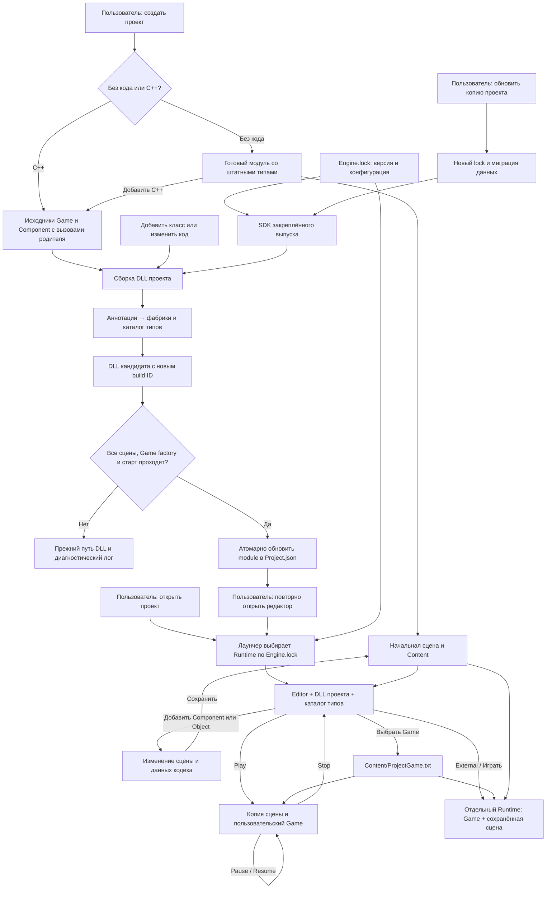

# Пользовательские проекты с C++

В лаунчере доступны создание проекта без кода и флажок «Проект с C++». В существующем штатном проекте можно нажать «Добавить C++…». Редактор предоставляет те же операции через меню «Проект → C++». Сцены и ресурсы сохраняются; неудачная первая сборка оставляет активной прежнюю DLL.

Для сборки нужен SDK закреплённого выпуска, Visual Studio с C++ tools и Windows SDK. Готовая игра и проект без кода запускаются без компилятора. Выпуск 2026.10.25.0 содержит SDK; для прежнего выпуска сначала обновите копию проекта. Переименование Engine.lock.json не заменяет это обновление.

## Исходники и сборка

Мастер создаёт Source/ProjectGame.h и .cpp, Source/ProjectComponent.h и .cpp, Source/Module.cpp, Game.sln, Game.vcxproj и Build.ps1. В C++ используется текущий API: AfterInitialize, PreUpdate, TickComponents у Game и Tick у компонента. Сгенерированные методы вызывают непосредственного родителя. Ваши файлы повторно не генерируются; временный GeneratedComponents.cpp находится в Intermediate.

Добавляйте заголовки и cpp в Source. Сборка обнаруживает их без ручного перечисления в vcxproj. Для генерации нового класса используйте меню редактора, для ручной разработки — аннотации ниже. Пользовательское отображаемое имя проекта может содержать кириллицу и пробелы; имя C++ класса должно быть допустимым идентификатором.

В окне «Добавить C++ класс…» укажите имя латиницей, без пробелов и расширения файла: например, `MyCharacter` или `Character5454`. Имя `5454` недопустимо: первым символом должна быть буква или `_`. Мастер проверяет имя, родителя и наличие файлов до запуска генератора; пояснение ошибки остаётся рядом с введёнными данными. Пробелы по краям удаляются. Для наследника персонажа выберите назначение `Character`; после создания нажмите «Перекомпилировать / Hot Reload».

Команда «Перекомпилировать / Hot Reload» (Ctrl+Alt+R) собирает и проверяет отдельный кандидат, затем восстанавливает текущую edit-сцену в новой DLL без закрытия окна. Правки, выделение и камера сохраняются; после замены очищается история Undo. Сначала остановите Play. Неизменная сборка сохраняет историю. Ошибки оставляют старую сессию работоспособной. Подробности, ограничения и совместимость: [интерфейс редактора](EDITOR-WORKFLOW.md#перекомпиляция-и-совместимость).

Из PowerShell в папке проекта:

```powershell
./Build.ps1
# Для ещё не установленного распакованного выпуска:
./Build.ps1 -Runtime 'D:/PainEngine/Runtime'
```

SDK по умолчанию ищется в `%LOCALAPPDATA%/PainEngine/Engines/<version>/<configuration>/SDK`. Переменная PAINENGINE_ENGINE_STORE меняет корень хранилища. Game.sln предназначен для редактирования и компиляции в IDE; активировать проверенную DLL следует через Build.ps1 или интерфейс. Для IDE нужен установленный SDK; нельзя смешивать Debug/Release или произвольные toolset. Binaries/IDE не переключает Project.json.

Результаты находятся в Binaries/<configuration>/<build-id>, временные файлы — в Intermediate. Project.code.json хранит состояние сборки. Успешная сборка обновляет module в Project.json; Engine.lock.json остаётся прежним. Предыдущая DLL не удаляется. Project.json.before-build позволяет увидеть предыдущий путь модуля.

Ошибки: Console в редакторе, CodeBuild.log при запуске из лаунчера, validate.log / validate-error.log и startup.log / startup-error.log в каталоге кандидата. Неподходящая DLL, неизвестный класс, ошибка загрузки сцены или отказ стартового запуска не переключают активный модуль. Проверка запуска выполняет три кадра; она не может проверить всю пользовательскую логику. На время сборки из редактора его редактирование заблокировано, чтобы проверяемые сохранённые данные не менялись.

## Действия пользователя и архитектура запуска



Штатный модуль и начальная сцена остаются удобной отправной точкой. Исходники проекта принадлежат пользователю. Ресурсы меняются через Content, код — через сборку DLL; смена выпуска движка выполняется отдельным обновлением копии. После обновления C++ проекта его код нужно пересобрать SDK нового выпуска. Уже установленные runtime не перезаписываются сборкой игры.

## Компоненты и классы игры

```cpp
#include <Engine/Components/GameComponents.h>

ENGINE_COMPONENT("Mover", "MyProject.Mover")
class Mover : public GameComponent
{
public:
    void Tick(float deltaTime) override
    {
        GameComponent::Tick(deltaTime);
        // Игровая логика. Базовый GameComponent не задаёт геометрию.
    }
};
```

Тип будет доступен в палитре после успешной сборки. Допустимо косвенное наследование через собственную базу. Нужны публичное однозначное наследование, доступный конструктор без обязательных аргументов и конкретный класс. Непомеченная абстрактная база остаётся обычным C++ классом; попытка зарегистрировать её как создаваемый компонент — ошибка компиляции.

Для Game используется ENGINE_GAME("Название", "устойчивый.ID"). В «Классах проекта» выберите его и нажмите «Выбрать Game». Выбор хранится в Content/ProjectGame.txt и действует для следующего Play, External и запуска из лаунчера. При отсутствии выбора используется первый Game в отсортированном каталоге. Неизвестный выбранный ID вызывает ошибку, а не тихую замену класса.

Редакторская сцена использует нейтральный Game; пользовательский Game создаётся для игры. Конструктор класса не должен запускать симуляцию или требовать уже созданное окно. AfterInitialize вызывается после подготовки ресурсов. PreUpdate и TickComponents участвуют в общей симуляции встроенного Play и отдельной игры. Edit/Pause не выполняют игровые тики.

Второй аргумент аннотации необязателен. Без него ID равен полному имени C++ класса. Устойчивый ID позволяет переименовать класс, сохранив читаемость сцены; существующие имена типов нельзя менять без сохранения прежнего ID или отдельной миграции.

## Другие иерархии

ENGINE_OBJECT регистрирует конкретный тип, не обязанный наследовать Game или GameComponent. В палитре он обозначается `[Object]`. Scene владеет неотрисовываемой оболочкой, а оболочка — настоящим объектом T. Сам пользовательский класс не получает искусственного наследования. Выделение такого объекта доступно через иерархию; геометрии для выбора мышью у него нет.

Пример независимой иерархии с явным кодеком:

```cpp
#include <Engine/Components/ProjectObject.h>
#include <nlohmann/json.hpp>

class RulesBase { public: virtual ~RulesBase() = default; };

ENGINE_OBJECT("Rules", "MyProject.Rules")
class Rules : public RulesBase
{
public:
    int limit = 20;
};

template<> struct ProjectObjectAdapter<Rules>
{
    static std::unique_ptr<Rules> Create() { return std::make_unique<Rules>(); }
    static void Tick(Rules&, float) {}
    static std::string Save(const Rules& value)
    {
        return nlohmann::json{{"version", 1}, {"limit", value.limit}}.dump();
    }
    static void Load(Rules& value, const std::string& text)
    {
        if (text.empty()) return;
        auto json = nlohmann::json::parse(text);
        if (json.at("version") != 1) throw std::runtime_error("Unknown Rules schema");
        const auto limit = json.at("limit").get<int>();
        if (limit < 0) throw std::runtime_error("Negative limit");
        value.limit = limit; // Применять только после полной проверки.
    }
};
```

Без специализации адаптера доступны default constructor, отсутствие тика и отсутствие сохраняемых данных. Для конструктора с параметрами специализируйте Create. Деструктор должен корректно освобождать объект; T и его фабрики не покидают DLL. Сложные шаблонные типы можно обернуть обычным именованным классом: генератор аннотаций не является полным C++ парсером.

## Данные объектов

Компоненты переопределяют SaveProjectData/LoadProjectData, независимые объекты — методы адаптера. Возвращается UTF-8 JSON-объект с полем version. Этот путь используется для сохранения/загрузки, Undo/Redo, Duplicate и копии Play. Наличие данных переводит сохраняемую сцену в формат 3; сцены без новых данных сохраняют свой формат. Старые readers не должны читать новые документы под видом v1/v2.

В редакторе «Данные выбранного объекта…» позволяет изменить объявленный кодеком JSON. Это редактор явных данных типа, а не автоматическая рефлексия всех членов C++. Кодек обязан сначала валидировать вход и только затем менять объект. Приватные указатели, ресурсы GPU и transient-состояние сериализовать нельзя.

Для ссылок используйте ID объектов и RemapProjectReferences у компонента либо необязательный ProjectObjectAdapter<T>::Remap у независимого типа. При полном восстановлении передаётся отображение старых ID в новые; при Duplicate — отображение ID оригинала в ID копии. Если ID отсутствует в карте, решение о сохранении/отказе принимает ваш кодек по своему контракту. Адреса объектов не являются постоянными идентификаторами.

## Видимость и ограничения

Полная [таблица возможностей, классов Engine и классов примеров](PROJECT-CAPABILITIES.md) показывает доступность в SDK, палитре и выборе Game.

Классы игр Pong/SunGame/Battle/Katamari не появляются в новом проекте автоматически: их исходники принадлежат примерам. Для использования в собственном проекте нужно перенести подходящие исходники и зависимости, затем зарегистрировать тип. Унаследованный Render/asset код может требовать отдельной инициализации.

В этой реализации независимые объекты принадлежат сцене через адаптер. Автоматических сервисов уровня всего проекта, автоматического отображения private-полей и универсального мастера всех виртуальных методов произвольной базы нет. Мастер Game/Component создаёт известные hooks; неподходящая база, final-метод или недоступный конструктор дают диагностику компилятора.
# Базовый пример C++: вращающийся куб

При первом подключении C++ генератор создаёт `Source/RotatingCube.h/.cpp`.
`ProjectGame::AfterInitialize` добавляет этот куб при запуске Play или отдельной игры,
если в сцене ещё нет экземпляра `RotatingCube`. Поэтому сохранённая сцена при
подключении C++ не переписывается. Для размещения куба в Edit выберите его в
категории классов проекта после сборки. Он вращается в Play, а в Edit стоит.

`Tick` прибавляет `90 * deltaTime` к повороту Y в **градусах**, не меняя позицию.
В сгенерированном `ProjectGame` масштаб времени равен 1. При Pause поворот
останавливается, Stop восстанавливает рабочую сцену. Уже созданные C++ проекты
автоматически не переписываются. Полный пример ввода R/N и назначения модели
находится в `docs/tutorial/examples`.

