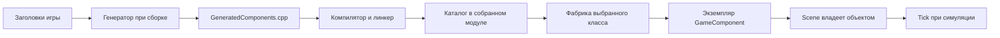

# Пользовательские компоненты: обнаружение и генерация C++

Интеграция с viewport и Play теперь доступна через [Edit session API](EDIT-SESSION-API.md).
Код UI редактора этим механизмом автоматически не меняется.

Контракт первого этапа для автора игры и разработчика редактора. Реализованы аннотация,
обнаружение классов при сборке, каталог типов и фабрики. Редактор пока не показывает
каталог. JSON, ENGINE_PROPERTY, новый lifecycle Play и передача каталога через DLL
ещё не входили в первый этап. В следующем этапе реализован [мост игрового модуля](SCENE-MODULE-API.md):
Scene хранит ключ типа, runtime получает каталог и команды. UI, JSON и свойства ещё впереди.

## 1. Что пишет автор игры

Создайте заголовок в `Game/<Name>/Source` подключённого к генератору проекта:

```cpp
#pragma once
#include <Engine/Components/GameComponents.h>

namespace MyGame
{
    ENGINE_COMPONENT("Вращающийся объект")
    class Rotator final : public GameComponent
    {
    public:
        void Tick(float deltaTime) override
        {
            // Своя игровая логика.
        }
    };
}
```

**Обязательная инструкция для шаблона проекта и справки редактора:**

> Наследуйте класс публично от GameComponent. Непосредственно над определением класса
> в заголовке Source напишите ENGINE_COMPONENT() либо ENGINE_COMPONENT("Название
> в редакторе"). Соберите проект.

GameComponents.h уже подключает определение макроса. Писать функцию регистрации,
менять Scene, править список типов или код движка не требуется. Заголовок не нужно
перечислять в `.vcxproj` для обнаружения. Если методы реализованы в отдельном `.cpp`,
он должен компилироваться проектом обычным способом.

`ENGINE_COMPONENT()` использует полное имя C++-класса и для отображения.
`ENGINE_COMPONENT("Название")` меняет только подпись. Ключ типа всегда
`MyGame::Rotator`, с учётом регистра и namespace. Подписи могут совпадать;
UI должен уметь показать полное имя для различения. Переименование класса/namespace
меняет ключ: будущему JSON-загрузчику понадобятся миграции/алиасы. Подпись не ключ.

Класс должен быть конкретным, с публичным конструктором без обязательных аргументов,
публичным однозначным наследованием GameComponent и доступным деструктором.
Промежуточная база допустима. Это проверяет компилятор C++, а не сканер.
Неотмеченные базовые классы не попадают в каталог.

Конструктор задаёт безопасные начальные значения. Он вызывается и при редактировании:
не должен запускать игру, требовать окно/GPU или обращаться к ещё не назначенной
Scene/Game. На этом этапе игровая логика остаётся в Tick. Новых BeginPlay/EndPlay нет.

## 2. Как это работает — без магии

Макрос ENGINE_COMPONENT пустой: препроцессор C++ убирает его из кода.
**Макрос не создаёт файлы.** Перед компиляцией MSBuild отдельно запускает утилиту:

1. ComponentGenerator читает заголовки и находит ENGINE_COMPONENT.
2. Определяет полное имя класса и необязательную подпись.
3. Записывает обычные GeneratedComponents.h и GeneratedComponents.cpp.
4. Компилятор собирает этот `.cpp` вместе с игровым кодом.
5. Собранная программа содержит таблицу типов и функции создания объектов.

Существенная часть результата:

```cpp
{"MyGame::Rotator", "Вращающийся объект",
 &EngineComponentDetail::Create<::MyGame::Rotator>, {}}
```

`Create<MyGame::Rotator>()` вызывает `std::make_unique<MyGame::Rotator>()`.
Компилятор знает настоящий класс, его конструктор и виртуальные методы.
При запуске поиск имени возвращает **уже скомпилированную функцию**. Её вызов
создаёт нужный C++-объект. Никакой компиляции при запуске нет. Перечисление типов
не создаёт экземпляров и не запускает пользовательские конструкторы.



## 3. Где увидеть результат

При стандартном Cpp.props:

```text
Engine/build/obj/x64/Debug/<ProjectName>/Generated/Components/
    roots.txt
    GeneratedComponents.h
    GeneratedComponents.cpp
```

Для Release путь аналогичен. Файлы можно открыть обычным редактором/Visual Studio;
target также добавляет их в элементы проекта. Они появляются после первой сборки.
Не редактировать и не коммитить: исходниками служат заголовки игры.
Изменение/удаление аннотации отражается при следующей сборке. Генератор проходит корни
на каждой сборке, но сохраняет timestamps неизменённых файлов, избегая лишней компиляции.

Ошибка разбора останавливает сборку. Все объявления проверяются до записи результата;
каждый файл заменяется через временный файл. Предыдущие generated-файлы могут остаться
для диагностики, но не позволяют успешно завершить ошибочную сборку. Последний бинарник
на диске также нельзя считать актуальным, если новая сборка завершилась ошибкой.

## 4. Однократное подключение проекта

Это работа шаблона проекта/интеграции сборки, не ручная регистрация каждого класса.
Проект должен использовать Engine/BuildSupport/Cpp.props и линковаться с Engine
для создания GameComponent. После Microsoft.Cpp.targets добавьте import
(путь относительно своего `.vcxproj`):

```xml
<Import Project="..\..\Engine\BuildSupport\ComponentGeneration.targets" />
```

Target сам собирает C++17-утилиту, сканирует `$(MSBuildProjectDirectory)\Source`,
добавляет generated `.cpp` в компиляцию и его каталог в include directories.
Python/Node.js не нужны. Используется установленный Visual C++/Windows SDK.
Не импортировать target в Engine: каталог принадлежит конкретной игре.

Необязательные настройки **до import**:

```xml
<PropertyGroup>
  <EngineComponentCatalog>MyGame</EngineComponentCatalog>
</PropertyGroup>
<ItemGroup>
  <EngineComponentRoot Include="$(MSBuildProjectDirectory)\Source" />
  <EngineComponentRoot Include="$(MSBuildProjectDirectory)\SharedComponents" />
</ItemGroup>
```

По умолчанию имя каталога — MSBuildProjectName; нужен допустимый C++-идентификатор.
Проектам с дефисами/пробелами задайте отдельное имя, например MyGame.
Корни перечисляются каталогами; пересекающиеся/повторные пути дедуплицируются.
Несуществующий корень — ошибка, существующий пустой — допустимый пустой каталог.
Не добавлять Engine, сторонние библиотеки и build в корни игровых компонентов.
Используйте разные имена каталогов для проектов одного бинарника. Дубликат полного
имени класса внутри каталога — ошибка.

Подключённый пример: Engine/tests/component-generation/ComponentGenerationTests.vcxproj.
RuntimeExample теперь подключён как тестовый игровой модуль: см. [Scene module API](SCENE-MODULE-API.md).
Базовый Game DLL API v4 сохранён, каталог доступен через отдельное расширение v1.
Другие игры и Editor пока не подключены. Import не заменяет настройку линковки
и интеграцию сессии модуля и не реализует hot reload.

Ручной запуск для диагностики:

```text
ComponentGenerator.exe <roots.txt> <output-directory> <CatalogIdentifier>
```

roots.txt — UTF-8, один каталог на строку. Target записывает абсолютные пути.
Код возврата 0 — успех, 1 — ошибка. Диагностика объявлений содержит файл и строку.

## 5. Действующий C++ API

Публичный контракт: Engine/Components/ComponentType.h. Сгенерированный вход:

```cpp
#include "GeneratedComponents.h"
auto catalog = EngineGenerated::MyGame::GetComponentTypes();
```

| Элемент | Контракт |
|---|---|
| catalog.data / size | Заимствованный неизменяемый массив; пустой — nullptr / 0 |
| catalog.Find(typeName) | Поиск по полному имени; nullptr для неизвестного; ничего не создаёт |
| type.typeName | Полное имя C++ с namespace; ключ типа |
| type.displayName | Подпись UTF-8, не уникальный ключ |
| type.create() | Новый независимый unique_ptr<GameComponent>; без AddComponent и Tick |
| type.visualDefaults | Пустая заготовка геометрии/материала |

Каталог сортируется по typeName. Массив, строки и фабрики живут до выгрузки владельца
кода. Не сохраняйте их адреса в сцене/JSON/UI. Получение каталога не меняет Scene.
Пользовательский конструктор может бросить исключение: создающий слой обрабатывает
его и показывает ошибку, не меняя документ частично.

Пример команды создания **внутри владельца Scene, в потоке движка**:

```cpp
const auto* type = catalog.Find("MyGame::Rotator");
if (!type) { /* сообщить UnknownType, сцену не менять */ }
else
{
    auto object = type->create(); // исключение обработать на границе команды
    auto result = scene.AddComponent("Rotator 1", object, type->typeName);
    // Ok/Deferred: Scene приняла владение, object == nullptr.
    // Иная ошибка: object остался у вызывающего, уничтожится автоматически.
    // result.id — ID экземпляра, не ключ типа.
}
```

Дальнейшее редактирование, Deferred, владение — [SCENE-EDITOR-API.md](SCENE-EDITOR-API.md).
Создание/добавление не запускают Tick. Отображение и разрешение симуляции остаются
ответственностью действующего runtime.

## 6. Инструкция следующему агенту: связь с редактором и JSON

Текущий реализованный мост описан в [SCENE-MODULE-API.md](SCENE-MODULE-API.md).
Ниже общая последовательность интеграции; UI и JSON остаются будущими задачами:

1. Владелец игрового кода получает generated-каталог и предоставляет его слою команд
   сцены. Генератор не знает ни Editor, ни конкретную игру.
2. Через версионированный module bridge передаются копии ключа/подписи типа,
   впоследствии ресурсные ссылки. Редактор отображает список.
3. UI отправляет команду с ключом типа, именем экземпляра и transform. Владелец сцены
   находит фабрику, создаёт объект и добавляет его через Scene.
4. UI получает результат/ComponentId и снимок. Правки идут через команды Scene,
   а не через указатели редактора на GameComponent.
5. Для JSON нужно хранить ComponentId → ключ типа и начальные данные. Теперь
   SceneComponentSnapshot содержит typeName, но ещё не является сериализованным документом.
   Не пытайтесь восстановить ключ через RTTI typeid().name().
6. Будущий загрузчик ищет тот же ключ в том же каталоге, вызывает ту же фабрику,
   затем применяет данные и связывает объекты вторым проходом. Неизвестный тип
   требует отдельной политики сохранения данных; не заменять его молча базовым классом.
7. Play создаёт отдельные экземпляры из начальных данных; Stop уничтожает игровую
   копию, Pause только прекращает симуляцию. Это этап 035-E, ещё не часть генератора.

**Граница DLL:** ComponentTypeCatalog — локальный C++ API, не экспортируемый ABI.
Не передавать unique_ptr, Scene, STL и create в Editor.dll. Создание/владение/уничтожение
остаются на стороне владельца Scene и кода; для внешней границы нужны отдельно
согласованные handles, команды и копирование строк. Нельзя выгружать DLL при живых
компонентах, vtable или заимствованных дескрипторах. Генератор не решает hot reload.

## 7. Заготовка геометрии и материала

```cpp
struct ComponentVisualDefaults
{
    const char* geometryAsset = nullptr;
    const char* materialAsset = nullptr;
};
```

Поле находится в описании типа; генератор всегда оставляет оба значения nullptr.
Это место для будущих ресурсных идентификаторов начального внешнего вида. Никаких
GPU-указателей, загрузки мешей/материалов, применения к объекту или изменений рендера.
Способ задания пользователем, формат ссылок, наследование defaults и переопределение
на экземпляре ещё не согласованы. Поэтому нет дополнительных аргументов аннотации
или setters. Структуру допускается уточнить позже. nullptr не означает создание куба.

## 8. Поддерживаемый синтаксис

Это ограниченный сканер деклараций, не полная reflection/preprocessor C++:

- UTF-8 заголовки .h/.hpp/.hh рекурсивно в корнях; .cpp сканируются для диагностики
  ошибочно размещённой аннотации.
- ENGINE_COMPONENT непосредственно перед `class Name [final] : ... { ... }`.
  Глобальная область либо именованные namespace, включая A::B и inline namespace.
- Подпись — один обычный строковый литерал, либо пустые скобки. Пишите UTF-8 прямо:
  конкатенация, wide/raw-подписи и числовые escape-коды не поддерживаются.
  Комментарии и строки/raw-строки исходников не считаются аннотациями.
- Шаблоны, вложенные/локальные классы, анонимные namespace, struct, forward declaration,
  атрибуты/экспортные макросы между аннотацией и именем не поддерживаются.
- Не размещать отмеченные классы внутри #if/#ifdef и не менять базу через директивы.
  Допустим #pragma once либо ведущие #ifndef GUARD / #define GUARD с завершающим #endif.
  Сканер не вычисляет условия препроцессора.
- Не создавать обнаруживаемые классы и namespace другими макросами: сканер их
  не раскрывает. Объявление должно быть явным текстом заголовка.
- ENGINE_PROPERTY выдаёт явную ошибку not supported yet. Поля не перечисляются
  и не сериализуются этим этапом.

Замеченная неподдерживаемая форма аннотации останавливает генерацию. Окончательную
валидность C++ и требования наследования проверяет компилятор. Для расширения до
произвольного синтаксиса можно заменить сканер AST-инструментом, сохранив каталог
и фабрики потребителей.

## 9. Проверки без редактора

Из корня репозитория:

```powershell
./Engine/tests/component-generation/run.ps1 -Configuration Debug -PlatformToolset auto
```

Скрипт собирает утилиту, Engine и отдельный консольный тест. Не запускает Editor,
EngineRuntime, окно или графическое устройство. Проверяет обнаружение/подписи/namespace,
фабрики и реальные экземпляры, владение Scene, отсутствие Tick при создании и виртуальный
Tick при симуляции. Также ошибки синтаксиса, дубликаты, условия, добавление заголовка,
удаление типа, пустой каталог, повторные корни, стабильные timestamps, сохранность
результата при ошибке. Компилятор отдельно отклоняет абстрактный класс, private-базу,
отсутствие default-конструктора и неверную базу; пустой каталог успешно собирается.

Артефакты/логи остаются в Engine/build/component-generator-tests. Запуски одной
конфигурации должны идти последовательно. Debug: интеграция, 17 проверок сканера,
4 ожидаемые ошибки компиляции и сборка пустого каталога пройдены (v143).
