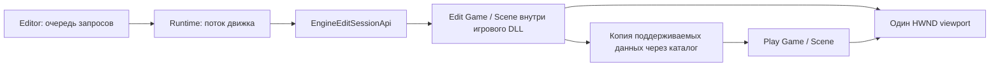

# Подключение игровой сцены к редактору: API движка/runtime

Этап 040. Код Editor/Qt не изменялся. Реализованы отдельная edit-сессия игрового DLL,
одна сцена для команд и отображения, Play из данных в памяти, Pause/Resume/Stop,
мост для подключения потребителя API. В этапе 040 JSON, свойства, UI и ресурсы нового формата
не добавлялись. Пример подключения игровой стороны — RuntimeExample.

Обновление 041: файловые операции были добавлены в ABI v2, см. [SCENE-JSON.md](SCENE-JSON.md).
Обновление 045: ABI v3 добавил picking/focus; Qt UI и пользовательские проекты подключены, см. [USER-PROJECTS.md](USER-PROJECTS.md).
Текущий ABI v5 включает ресурсы из v4 и Scene API v3 с параметрами точечного света.
Цвет, интенсивность, радиус и включение сохраняются в JSON и Play-копии; изменения
через scene.setPointLight запрещены в Play/Pause. Пересоберите DLL, runtime и Editor вместе.

## 1. Что уже работает и что подключает разработчик редактора

Проекты с `preview` сохраняют legacy preview. Проект со `startupScene` без `preview` автоматически открывается через edit session.
Явное подключение также доступно: RuntimeLaunchOptions.editModule = путь игрового DLL,
либо `EngineRuntime --project ... --mode editor --scene-api`.

Для этого пути Editor.dll реализует необязательный экспорт `EngineBindEditSession`.
Текущий Qt Editor копирует таблицу, выполняет команды в потоке движка и показывает
снимки в UI. Несовместимый сторонний Editor получает ошибку совместимости.

Заголовки:

- `Engine/Runtime/EditSessionApi.h` — ABI таблицы, состояния, команды и exports.
- `Engine/Runtime/GameEditModule.h` — host-владелец DLL и edit-сессии (RAII).
- `Engine/Runtime/SceneEditSession.h` — реализация внутри игрового DLL.
- `Engine/Runtime/SceneModuleApi.h` — уже существующие каталог и команды объектов.

## 2. Владение и отображение



Game здесь — существующая оболочка ядра, содержащая Scene и renderer. Используется
обычный Game, без производного игрового класса и его PreUpdate/AfterInitialize.
SceneCommands редактирует **ровно Game.GetScene()**, которую renderer обходит для
отображения. Второго списка/копии объектов между командами и renderer нет.
В Play отдельный Game владеет отдельной Scene; GPU device/swapchain разделяются
существующим механизмом InitializePlayViewport. Активные render targets у одной сцены.

Обе Game, Scene, фабрики и компоненты живут внутри игрового DLL. Host не получает
C++-указатели на них и не удаляет объекты. Открытие edit-сессии не вызывает обычные
EngineModuleApi.create/start/update игры. Автор игрового модуля явно предоставляет
edit-safe export; для старого DLL без него нет автоматического fallback на start.
Конструкторы компонентов по-прежнему должны быть безопасны для редактирования.

## 3. Экспорт игровой стороны

RuntimeExample сохраняет обычные ModuleApi v4 и SceneModuleApi v1 для game mode.
Дополнительно экспортирует:

```cpp
int __cdecl EngineGetEditModuleApi(
    uint32_t version, uint32_t outputSize, EngineEditModuleApi* output);
```

Версия — ENGINE_EDIT_API_VERSION = 3 (обновление 045). Сначала проверяются версия, размер и указатель;
при отказе output не изменяется. Таблица содержит:

```cpp
uint32_t version;
int (*create)(const char* engineContentRoot, EngineEditSessionApi* output);
void (*destroy)(void* context);
```

create принимает абсолютный UTF-8 путь к EngineContent (корню шейдеров), создаёт
SceneEditSession с generated-каталогом и возвращает её API. Это отдельная сессия,
а не EngineModuleApi.session. Исходно сцена пустая, state=Edit. Для загрузки JSON используйте loadScene; также
host может заполнить её командами. destroy выполняется тем же DLL до выгрузки.
Пример реализации целиком находится в Game/RuntimeExample/Source/Module.cpp.

EnginePaths имеет статическое состояние внутри DLL. Для одновременно открытых
сессий одного DLL использовать один EngineContent root. GameEditModule загружает
DLL напрямую, без shadow copy: пересборка/горячая замена открытого DLL не поддержана.

## 4. Получение таблицы в Editor.dll

Runtime создаёт edit-сессию, затем создаёт сессию Editor и **до Editor.start** вызывает:

```cpp
extern "C" __declspec(dllexport)
int __cdecl EngineBindEditSession(uint32_t version, uint32_t size,
    void* editorSession, const EngineEditSessionApi* api);
```

Минимальная логика реализации:

```cpp
if (version != ENGINE_EDIT_API_VERSION ||
    size != sizeof(EngineEditSessionApi) || !editorSession) return 0;
if (api && !IsCompleteEditSessionApi(*api)) return 0;
// Скопировать таблицу в состояние сессии редактора.
// api == nullptr: прекратить запросы, забыть таблицу и данные/ID этой сессии.
return 1;
```

Нельзя сохранять адрес аргумента api — нужна копия таблицы. context и указатели функций
в копии заимствованные, их владелец runtime. nullptr означает unbind и приходит **до
Editor.stop**. Возврат из unbind должен означать, что новых запросов уже не будет.
Editor никогда не вызывает destroy игровой сессии и не выгружает её DLL самостоятельно.

В новом режиме callbacks старого host.viewportAttach/Camera/Control не предоставляются:
использовать полученную таблицу. Не пытаться одновременно подключить legacy preview
и новую Scene к одному HWND.

## 5. Каталог, снимки и команды

| Поле таблицы | Назначение |
|---|---|
| scene | EngineSceneApi **постоянной редактируемой сцены** |
| control(context, command) | Явный Play/Stop/Pause/Resume |
| getState(context, state) | Edit=0, Playing=1, Paused=2 |
| readActiveScene(context, info, visitor, user) | Edit snapshot либо snapshot игровой копии |
| setParent(context, child, parent, inheritScale) | Иерархия Edit; parent=0 снимает родителя |
| attachViewport(context, hwnd, width, height) | Привязка существующего HWND |
| resizeViewport(context, width, height) | Размер в физических пикселях; ноль приостанавливает изображение |
| camera(context, right, up, forward, yaw, pitch, zoom) | Намерение камеры по прежней семантике MoveEditorCamera |
| frame(context, dt) | Один шаг симуляции при Playing, затем отображение активной сцены |

Подробности scene.listTypes/readScene/createObject/removeObject/renameObject/setTransform
и lifetime строк — [SCENE-MODULE-API.md](SCENE-MODULE-API.md). scene.readScene всегда читает
исходный документ, даже в Play. Для просмотра игрового состояния нужен readActiveScene.
ID относятся к конкретной Scene и сессии: численное совпадение edit/play ID не делает
их одной сущностью. После нового Play прежние игровые ID недействительны.

Новое значение результата EngineSceneReadOnly=8: все изменяющие команды Edit заблокированы
в Playing и Paused, включая setParent. Чтение каталога/снимков разрешено. Общая таблица
SceneModuleApi v1 не меняла layout; значение результата добавлено в enum.
setParent допускает inheritScale только 0/1; неверный родитель/цикл — InvalidArgument,
неизвестный child — NotFound. Transform остаётся локальным, quaternion x/y/z/w.

## 6. Потоки, callback и очередь

Сессию создаёт поток движка. На нём же выполняются все API-вызовы, frame, bind/unbind
и destroy. Вызов из UI-потока возвращает WrongThread; это не замена очереди.
UI должен скопировать значения запроса в собственную команду, поставить её в очередь,
а обработчик на потоке движка выполнить вызов между кадрами и вернуть ответ в UI.
UI не хранит заимствованные строки или указатели callback.

Каталог/снимки передаются синхронными visitor. Копировать строки во время callback;
не выбрасывать исключения и не обращаться повторно к API из visitor. Общий guard
блокирует reentry между scene-командами и control/frame с Busy. Busy не означает,
что команда поставлена в очередь: это отказ, запрос нужно перенести на границу кадра.

В режиме BaseEngine runtime **сам вызывает frame** после Editor.update и до overlay.
Editor.update только выполняет очередь команд. Editor/UI не должен дополнительно
вызывать frame — это даст второй шаг симуляции. Runtime ограничивает dt диапазоном
0..0.1 секунды. При самостоятельном host цикл и frame принадлежат этому host.

## 7. Viewport и срок жизни HWND

attachViewport вызывается один раз в Edit на существующем HWND с положительными
размерами. Повторное прикрепление или прикрепление в Play/Pause — Busy.
Сессию можно использовать без viewport, затем привязать окно к той же Scene.
Начальная камера находится в (0,0,5), смотрит к началу координат; её ввод задаёт host.

Окно принадлежит UI/host. Оно должно оставаться действительным до уничтожения
edit-сессии. Не менять HWND, не уничтожать его из UI до согласованного закрытия.
В этом этапе нет отдельного detach/rebind с сохранением документа: закрытие сессии
освобождает viewport и уничтожает Scene. Для временного скрытия/minimize передать
нулевой размер; вернуть положительный при показе. Игровая симуляция при нулевом размере
может продолжаться; чтобы заморозить её, использовать Pause.

При ошибке первичной инициализации viewport Edit-компоненты сохраняются; можно
восстановить доступность шейдеров и повторить attach. Это обеспечено узким параметром
Game.InitializeViewport(..., preserveSceneOnFailure=true), используемым только
для обычного Game с данными, без пользовательского AfterInitialize.
Обычный legacy Game сохраняет прежнее поведение обработки ошибки.

Компонент без геометрии существует в Scene и исполняет Tick в Play, но не получает
автоматического маркера/куба. Существующая геометрия компонентов отображается обычным
renderer. Формат геометрии/материала, их JSON и редакторские маркеры не добавлялись.

## 8. Play, Pause, Stop и ошибки

| Команда | Допустимое состояние | Результат |
|---|---|---|
| EnginePlay=0 | Edit | Новые объекты, новая Scene, state=Playing |
| EngineStop=1 | Playing/Paused | Уничтожена игровая копия, возвращена исходная Scene |
| EngineStop=1 | Edit | Успех без изменений |
| EnginePause=2 | Playing | Тот же объект/Scene, state=Paused |
| EngineResume=3 | Paused | Продолжение той же Scene |

Play в уже Playing/Paused возвращает Busy; остальные неверные переходы — InvalidArgument.
UI сам переводит Space в Play/Stop, P в Pause/Resume после getState. Движок не обрабатывает
клавиши в этом API.

Play сначала проверяет ключи всех типов, затем строит кандидата, не трогая Edit.
Копируются: имя Scene, ключ/имя объекта, position/rotation/scale, связи родителей и
inheritParentScale. Создаются новые ComponentId, связи восстанавливаются вторым проходом.
Камера копируется при наличии viewport. Произвольные C++-поля, экземпляры внутреннего
инстансинга, пользовательские ресурсные ссылки и состояние ввода **не сериализуются**:
для них остаются defaults конструктора. Пока нет ENGINE_PROPERTY и BeginPlay/EndPlay.

Если фабрика/восстановление данных/viewport Play дают ошибку, кандидат уничтожается,
состояние остаётся Edit, исходные объекты сохраняются, render targets восстанавливаются.
При невосстановимой ошибке device/targets host должен завершить сессию, а не бесконечно
повторять frame. Если Tick бросает исключение, игровая копия переводится в Paused,
frame возвращает EngineSceneSimulationFailed=9. Runtime сообщает ошибку и продолжает
работать с Paused-сценой; host может прочитать состояние или выполнить Stop.

frame принимает конечный dt от 0 до 0.1 включительно (секунды); иной dt — InvalidArgument.
Только Playing вызывает Scene.Tick(dt). В Edit/Paused Tick не вызывается даже с dt=0.
Renderer работает с отключённой симуляцией, поэтому второго Tick внутри отрисовки нет.
Пока это компонентная симуляция; старые пользовательские Game.PreUpdate, глобальные
правила старых игр и отдельные игровые часы шейдеров в эту edit-сессию не переносились.

## 9. Завершение и независимый host

Runtime выполняет порядок: unbind API потребителя → destroy edit-сессии (сначала Play,
затем Edit/GPU) → выгрузка game DLL → Editor.stop/destroy → закрытие UI-окна.
В unbind редактор прекращает команды и забывает таблицу, но ещё **не уничтожает HWND**.
Блокирующий reload старой сессии в этом режиме запрещён: сначала закрыть сессию.
Сохранение/загрузка добавлены в этапе 041: см. [SCENE-JSON.md](SCENE-JSON.md).

Прямой C++ host может обойти EditorModule целиком:

```cpp
// На одном потоке; module/content — абсолютные пути.
GameEditModule game(module, content);
const auto& api = game.Api();
api.attachViewport(api.context, hwnd, width, height);
// scene.listTypes/createObject/...; control(...); frame(...).
// game уничтожить ДО DestroyWindow(hwnd).
```

Старые ModuleApi/SceneModuleApi используются отдельно для обычной игровой сессии.
Не получать сцену через EngineGetSceneApi и одновременно другую через edit factory,
ожидая, что это один документ: это разные жизненные циклы и разные Scene.

## 10. Проверки без редактора

```powershell
./Engine/tests/edit-session/run.ps1 -Configuration Debug -PlatformToolset auto
./Engine/tests/scene-module/run.ps1 -Configuration Debug -PlatformToolset auto
./Engine/tests/run.ps1 -Configuration Debug -PlatformToolset auto
```

Текущий набор с JSON: 478 проверок (Debug v143), без исходников/сборки/запуска Editor и Qt.
Есть CPU-проверки, реальный игровой DLL, отдельное Win32-окно с D3D11 и ABI-only
consumer DLL для handshake BaseEngine. Проверены реальный draw, совпадение объектов
команд и renderer, Play/Pause/Stop, rollback ошибок конструктора/viewport, readonly,
потоки/reentry, иерархия, уничтожение и кадровый цикл runtime.
Ожидаемые сообщения об отсутствии шейдеров — специально внедрённые ошибки.
Регрессия: scene-module 109 проверок и ядро 13/13 прошли.

## Дополнение v3: выбор и камера

`ENGINE_EDIT_API_VERSION = 3`. К таблице добавлены `pickObject(context, x, y, &id)` и `focusObject(context, id)`. Координаты picking — NDC от −1 до +1, Y вверх. Успешный промах возвращает ID 0. Выбор проверяет CPU-треугольники объектов, созданных через `InitPoints`, с учётом world transform и родителей. Focus использует мировую позицию и ограничивающую сферу объекта. Обе операции требуют прикреплённый viewport и выполняются на потоке сессии. Старые бинарные таблицы v2 отвергаются; пересоберите Editor и игровой модуль. Формат scene JSON не изменился.
