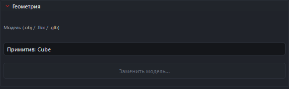

# Релизная ветка 0.3.0 — PR №24

Ветка `release/v0.3.0` создана от main после слияния
[PR №24](https://github.com/CakeWithMouse/Engine/pull/24) (`fix/editor-ui-bugfix`).
Это имя релизной ветки; внутренний номер сборки в `Engine/Version.json` —
`2026.11.11.0`. Форматы сцены и ABI этим PR не повышаются.

## Ресурсы и инспектор

- Модели и материалы выбираются в общем окне ресурсов проекта: поиск по имени,
  плитки, текущий выбор и подтверждение. Для текстур показываются миниатюры;
  модели и материалы обозначаются значками, это не 3D-превью.
- В «Геометрии» модель можно заменить только у `Engine.Model`. Примитив показывает
  свой тип; превращение примитива в модель заблокировано. Для нового объекта
  добавьте импортированную модель из Content. Замена модели поддерживает Undo/Redo,
  сохраняет остальные данные объекта; ошибочный ресурс не должен заменять сцену.
- Кнопки отдельной текстуры убраны из «Геометрии». Рабочий маршрут — открыть материал,
  выбрать текстуру для BaseMap или другого слота и сохранить материал. Старые
  ссылки текстур объектов и C++ API назначения текстуры остаются поддержанными.
- «Новая папка» в контекстном меню файловой панели создаёт каталог с уникальным
  именем и сразу включает переименование. Переименование папки остаётся в её
  родительском каталоге. Корни проекта и Content защищены; выход за проект,
  включая ссылки на внешние каталоги, запрещён. Переименование папки не является
  обещанием автоматического переноса всех ссылок на ресурсы: для ресурсов
  используйте существующую операцию переноса и проверяйте ссылки сцены.
- В файловой панели исправлены фильтры, названия типов и отображение моделей,
  текстур, аудио, материалов, C++ файлов и папок. Импорт и выбор используют
  согласованные списки расширений.

## Панели и viewport

- Карточки геометрии и материала обновляются при изменении их данных;
  обычные обновления сцены сохраняют раскрытие карточек, ввод и фокус.
- Завершения команд курсора и камеры не вызывают лишнюю перестройку панелей.
  Во время gizmo-перетаскивания обновления инспектора объединяются таймером 33 мс;
  последнее положение поступает в панели после последнего события.
- Панели сцены и инспектора разрешено прикреплять ко всем сторонам окна.
- Исправлены экранные размеры и выбор иконок объектов viewport, включая
  несимметричные изображения; результат зависит от размеров viewport.

## Совмещение с main

Сохранены карточки скриптов и автоматов ИИ, их опрос и фильтрация служебных
свойств. В SDK оставлен явный `-UseBuildToolset` для локального Debug;
Release сохраняет совместимость с базовым v142. Дополнительно исправлено
время жизни снимка сцены при выборе модели и материала.

## Проверка вручную

1. Импортируйте OBJ/FBX, PNG и WAV. Проверьте фильтры Content и создание папки.
2. Добавьте модель, замените её другой моделью, выполните Undo/Redo.
   У примитива замена на модель должна быть недоступна.
3. Выберите материал через поиск, откройте BaseMap и назначьте текстуру.
   Сохраните материал и сцену, откройте сцену повторно.
4. Сверните карточки инспектора, перемещайте объект gizmo и меняйте выделение.
   Проверьте итоговый transform и сохранение фокуса числового поля.
5. Перенесите инспектор вниз, отделите его и прикрепите обратно.
   Проверьте карточки скрипта и автомата ИИ на соответствующих объектах.

## Автоматическая проверка интеграции

14.11.2026: Debug / x64, полный `Editor/tools/test-regression.ps1 -Full`: CoreTests,
HostTests, UiTests, EngineTests, HudTests, EditorReloadTests и сценарии
UI-standard, authoring, workflow, recovery, layout, reload — PASS.
`Engine/tests/run-viewport.ps1` проверил D3D readback для размеров иконки
16/32/64 px на расстояниях 1/3/15/60; тест жизненного цикла подсистем — PASS.
HTML: 8 страниц, 57 разделов API, 461 ссылка на объявление, 132 локальные ссылки;
поиск, изображения и мобильная ширина — PASS.

Презентации: туториал r11 (91 слайд), изменения r4 (22 слайда), PPTX и PDF.
Проверены структура пакетов, геометрия слайдов, новые снимки и текст.
Исторические иллюстрации сохранены с оговоркой об их версии; новые окна выбора
сняты с реальных Qt-компонентов на учебных ресурсах.

