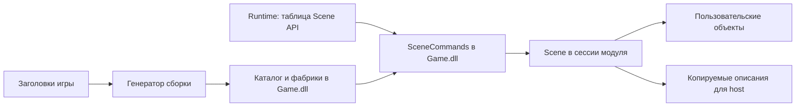

# Каталог и команды Scene через игровой модуль

Продолжение 040: [edit-safe сессия, тот же Scene во viewport и Play из копии](EDIT-SESSION-API.md).
Ниже описан прежний API обычной игровой сессии; edit-сессия имеет отдельный lifecycle.

Этап 039: реализованы отдельное расширение игрового DLL, его обнаружение runtime,
создание по generated-каталогу, чтение снимка и команды редактирования. Проверенный
потребитель — Game/RuntimeExample. UI, JSON, свойства, рендер пользовательских классов
и Play-копия документа в этот этап не входят.

## 1. Устройство и владение



Ядро содержит Scene и общий адаптер SceneCommands. Игра определяет классы, генератор
создаёт каталог. Сессия игрового модуля создаёт **экземпляр ядровой Scene внутри DLL**.
Там же вызываются конструкторы/деструкторы компонентов. Runtime владеет временем жизни
сессии: create/start → вызовы → stop/destroy → выгрузка.

Engine — статическая библиотека: DLL и host могут иметь собственные статические
переменные ядра. SceneId не глобален для всех DLL. C++-объекты, unique_ptr и владение
не пересекают границу модулей. В ABI нет GPU-указателей и STL.

Основные файлы:

- `Engine/Include/Engine/Runtime/SceneModuleApi.h` — ABI-структуры и таблица.
- `Engine/Include/Engine/Scene/SceneCommands.h` и `Engine/Source/Scene/SceneCommands.cpp` — адаптер.
- `Game/RuntimeExample/Source/Module.cpp` — подключение сессии и экспорт.
- `Game/RuntimeExample/Source/Mover.h` — автоматически обнаруживаемый класс.
- `Engine/Source/Base/Base.cpp` — запрос расширения при загрузке DLL.

## 2. Однократное подключение модуля

Проект DLL линкуется с Engine и импортирует ComponentGeneration.targets по
[инструкции генератора](COMPONENT-GENERATION.md). Регистрация каждого класса не нужна.
В шаблон игрового модуля один раз добавляется:

```cpp
#include <Engine/Scene/SceneCommands.h>
#include "GeneratedComponents.h"
struct Session
{
    Scene scene{"Module scene"};
    SceneCommands commands{scene, EngineGenerated::MyGame::GetComponentTypes()};
    bool started = false;
};
```

Порядок полей важен: commands уничтожается раньше scene. Каталог живёт дольше сессии.
SceneCommands проверяет обязательные поля/дубликаты каталога, не вызывая фабрики.
Конструирование сессии может бросить исключение; module create ловит его и возвращает
nullptr. RuntimeExample уже это делает.

Дополнительный экспорт:

```cpp
extern "C" __declspec(dllexport)
int __cdecl EngineGetSceneApi(uint32_t version, uint32_t outputSize,
    void* instance, EngineSceneApi* output)
{
    if (version != ENGINE_SCENE_API_VERSION ||
        outputSize != sizeof(EngineSceneApi) || !instance || !output)
        return 0;
    auto* session = static_cast<Session*>(instance);
    if (!session->started) return 0;
    *output = session->commands.GetApi();
    return 1;
}
```

instance — действующая сессия, возвращённая create этого DLL. Произвольный ненулевой
указатель не валиден. started выставляется после успешного start, сбрасывается в stop.
Запрос до start/после stop отвергается. При отказе output не изменяется.

## 3. Версии и получение на стороне host

Базовый EngineModuleApi остался v4. Scene-расширение независимо: версия 1 плюс проверка
размера таблицы. Windows x64, стандартная упаковка, C calling convention, UTF-8 строки.
После успешного start игрового модуля runtime ищет EngineGetSceneApi:

- Экспорта нет — старый модуль работает без команд сцен.
- Получена полная корректная таблица — расширение доступно host.
- Экспорт отверг версию/размер либо таблица неполная — ошибка загрузки, затем
  stop/destroy и выгрузка. Работа с частичным API не разрешается.

```cpp
EngineSceneApi api{};
if (engine.TryGetActiveSceneApi(api))
{
    // Только поток сессии и граница между обновлениями.
}
```

При false output очищается. Это host C++ API, не новый callback EngineModuleHost
для Editor.dll. Текущий editor mode загружает Editor.dll вместо отдельной игровой
сессии — игрового Scene API там пока нет. Прямой тестовый host использует GetProcAddress
и вызывает экспорт с версией, sizeof(EngineSceneApi) и действующей сессией.

## 4. Действующие операции

Первый аргумент — api.context, непрозрачный заимствованный сервис модуля.
Его нельзя разыменовывать, удалять или использовать после закрытия сессии.
Все функции возвращают uint32_t со значением EngineSceneStatus.

| Функция | Контракт |
|---|---|
| listTypes(context, visitor, user) | Синхронно перечисляет типы, не создаёт объектов |
| readScene(context, info, visitor, user) | Возвращает сведения о Scene и перечисляет снимки объектов |
| createObject(context, typeName, name, transform, id) | Создаёт конкретный класс по ключу, Scene принимает владение |
| removeObject(context, id) | Удаляет объект внутри модуля |
| renameObject(context, id, name) | Меняет имя экземпляра, сохраняет ID и ключ типа |
| setTransform(context, id, transform) | Задаёт локальные position/rotation/scale |

listTypes требует visitor. EngineSceneTypeInfo содержит typeName, displayName,
geometryAsset/materialAsset (пока nullptr). Ключ — полное C++-имя, подписи не уникальны.

readScene требует info и visitor. EngineSceneInfo: id, revision, objectCount.
EngineSceneObjectInfo: id, name, typeName, parentId, inheritParentScale и transform.
Порядок объектов — по ID. Пустая сцена успешно возвращает count=0 без callback.
Команд изменения иерархии через DLL на этом этапе нет.

Сначала создаётся независимый C++ snapshot, затем вызываются visitor.
**Запись и все строки доступны только на время callback.** Host копирует значения
в свою память, не сохраняет адреса. Callback синхронный; нельзя бросать исключения,
повторно вызывать команды, уничтожать сессию или выгружать DLL. При ошибке выделения
памяти visitor должен записать локальный признак ошибки и вернуться; host отбрасывает
частично скопированный результат. Исключение не должно выходить из callback.

Входные строки — UTF-8 C-строки, действительные до возврата. Scene копирует имя
и ключ типа. Входные указатели после вызова не хранятся. Передаваемые адреса должны
ссылаться на доступную память: ABI действует внутри доверенного процесса.

## 5. Создание и transform

```cpp
EngineSceneTransform t{{0,0,0}, {0,0,0,1}, {1,1,1}};
uint64_t id = 0;
uint32_t result = api.createObject(api.context,
    "RuntimeExample::Mover", "Mover 1", &t, &id);
```

position: x/y/z; rotation: quaternion **x/y/z/w**; scale: x/y/z.
Кватернион нормализуется setter компонента. Позиция/масштаб конечны; модуль каждой
компоненты scale не меньше 1e-6, отрицательный масштаб допустим. Квадрат длины
кватерниона конечен и не меньше 1e-12.

Для create transform=nullptr сохраняет defaults конструктора. Нулевая инициализация
всего transform **не единичное преобразование**: нулевые scale/quaternion отклоняются.
Для setTransform nullptr — ошибка.

Сервис проверяет аргументы/поток/занятость, наличие типа, уникальность имени и transform.
Затем вызывает фабрику, задаёт transform и добавляет объект вместе с копией typeName.
Ошибки типа/имени/transform проверяются до конструктора. Исключение/пустая фабрика
дают Failure без добавления. При неуспехе *id=0, если указатель id передан.
Ни create, ни добавление не вызывают Tick. Конструктор не должен запускать игру
или делать внешние побочные действия — сервис не может откатить пользовательские
действия вне Scene.

## 6. Результаты, поток и ошибки

| Результат | Смысл |
|---|---|
| Ok (0) | Команда завершена |
| InvalidArgument (1) | Обязательный nullptr, пустое имя/ключ, неверный transform |
| UnknownType (2) | Ключ отсутствует в каталоге |
| NotFound (3) | ID отсутствует |
| DuplicateName (4) | Имя экземпляра занято |
| Busy (5) | Выполняется команда/visitor либо Scene update |
| Failure (6) | Исключение фабрики/реализации, пустой результат фабрики, внутренняя ошибка |
| WrongThread (7) | Вызов не с потока, создавшего SceneCommands |

Внешний сервис не принимает отложенные команды: внутри BeginUpdate возвращает Busy.
Поэтому Ok означает завершённое создание/удаление, без неоднозначного Deferred.
Внутренний Scene API сохраняет своё прежнее поведение. Исключения реализации
перехватываются в модуле, не пересекают ABI.

Очереди и mutex здесь нет. UI должен маршрутизировать запросы на поток сессии.
Busy — перенести вызов на границу кадра; WrongThread — исправить маршрутизацию;
не крутить повторные попытки на UI-потоке. Диагностика WrongThread не разрешает
вызывать сервис одновременно с уничтожением сессии. После ошибки не подтверждать
изменение документа; после NotFound перечитать сцену.

## 7. Ключ типа, идентичность и revision

В C++ Scene.AddComponent появился необязательный третий аргумент typeName.
Он копируется в компонент и в SceneComponentSnapshot.typeName. Старые двухаргументные
вызовы работают с пустым ключом. Scene не проверяет ключ по каталогу — это делает
SceneCommands. Не выводить ключ из RTTI, имени экземпляра или displayName.
Rename/transform его не меняют; удаление уничтожает объект и строку.
Это заготовка данных для JSON, не готовая сериализация.

Внешняя ссылка: **поколение сессии + SceneId + ComponentId**. После reload/новой сессии
все старые ID недействительны, даже при совпадении чисел. Поколение ведёт host, оно
не добавлено в ABI этого этапа. ComponentId не переиспользуется внутри одной Scene.

revision отражает изменения через API Scene. Прямой setter из пользовательского Tick
может не увеличивать revision. Покадровый просмотр игры не должен полагаться только
на revision как признак неизменности transform.

## 8. Завершение и reload

1. Прекратить новые запросы, завершить текущую команду/visitor.
2. Забыть таблицу Scene API, context, заимствованные адреса и ID сессии.
3. Вызвать module.stop, затем module.destroy.
4. Destroy внутри DLL уничтожает SceneCommands, Scene и оставшиеся компоненты.
5. Только затем FreeLibrary.

BaseEngine очищает свою таблицу до stop/destroy, включая ошибку загрузки и reload.
Выданные копии автоматически обнулить невозможно — их владелец соблюдает этот контракт.
Пользовательский деструктор не должен бросать исключения.
В RuntimeExample stop сбрасывает started, Scene живёт до destroy. Повторный start
сессии не обещается. Reload уничтожает данные сессии: это не перенос состояния и
не будущий Stop игровой копии документа.

## 9. Следующий шаг разработчика редактора

Текущий editor mode использует прежнюю ViewportSession/preview-сцену и загружает только
Editor.dll. Новая Scene принадлежит игровой сессии RuntimeExample: это **другая сцена**,
пока без viewport-рендера. Старые Space/Pause/Stop этим этапом не меняются.

Дальнейшая интеграция:

1. Добавить игровую edit-сессию рядом с Editor.dll и получить её API. Согласовать
   безопасный lifecycle: start произвольной старой игры может запускать игровую логику;
   нельзя считать любой существующий модуль пригодным для статичного Edit.
2. Предоставить редактору host-сервис команд и копий данных. Не передавать сырые
   адреса Scene/GameComponent или C++-фабрики в Editor.dll.
3. Показать копию каталога; displayName — подпись, typeName — ключ выбора.
4. Команды направлять на поток сессии, по Ok обновлять снимок/Hierarchy. Добавить
   историю документа/Undo, не считать ошибочную команду выполненной.
5. Привязать рендер именно к редактируемой сцене. Геометрия/материал пока зарезервированы;
   не предполагать автоматическую загрузку мешей или GPU-ресурсов.
6. Добавить JSON и отдельные игровые экземпляры из начальных данных. Изменение
   копии SceneComponentSnapshot само по себе не меняет Scene и не создаёт объектов.

До этого Mover не появляется в UI, а новые команды не меняют нынешний preview.

## 10. Проверки

```powershell
./Engine/tests/scene-module/run.ps1 -Configuration Debug -PlatformToolset auto
./Engine/tests/run.ps1 -Configuration Debug -PlatformToolset auto
```

Первый скрипт собирает Engine, RuntimeExample DLL, консольный host и тестовые DLL.
Editor/Qt/EngineRuntime.exe не собираются и не запускаются. Тест использует реальный
LoadLibrary/GetProcAddress и BaseEngine в game mode без окна/GPU.

Debug v143: 109 проверок пройдены. Каталог, фабрики, реальный Tick, transform, снимки,
ключ типа, rename/remove, ошибочный конструктор, аргументы, Busy/WrongThread/reentry,
уничтожение/выгрузка, версия/размер, старый модуль без расширения и неполный API.
Два RuntimeError для специально неверных DLL ожидаемы. Прежние тесты ядра: 13/13;
их графические проверки используют WARP, но не редактор. Старый warning C4996/getenv
в Base.cpp не изменялся.
